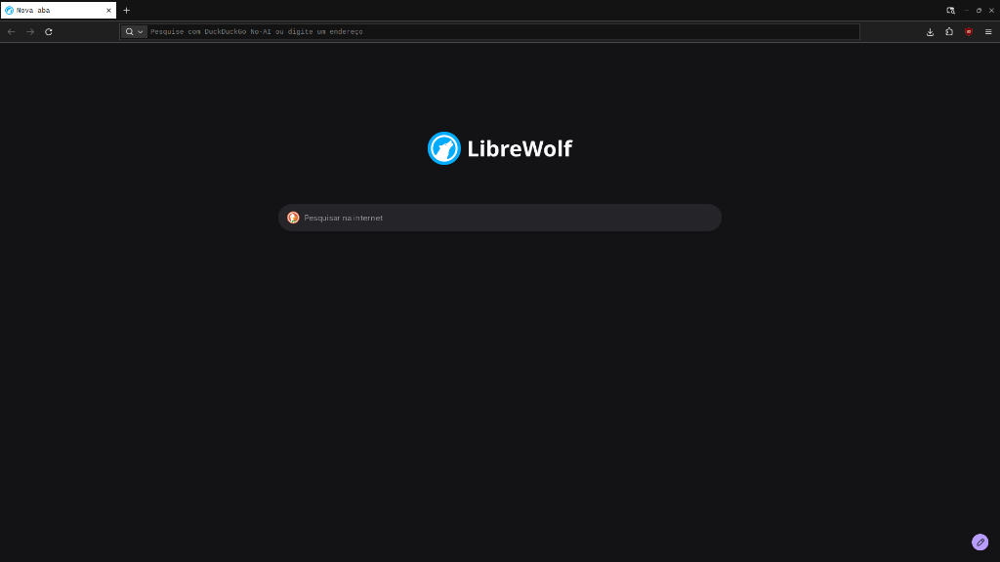
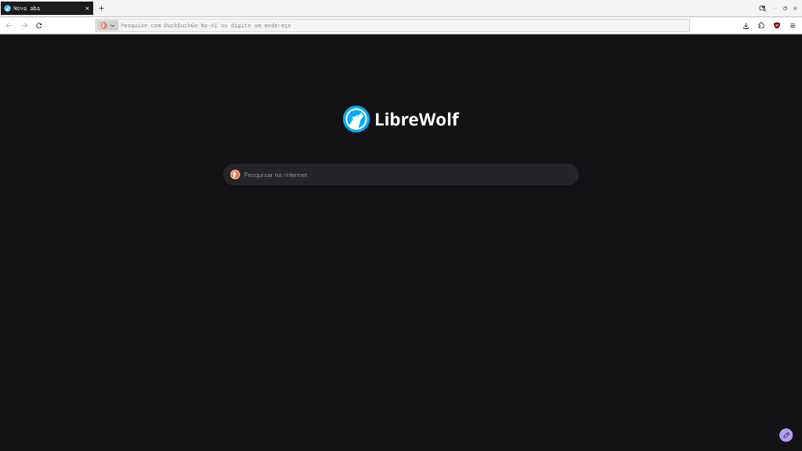
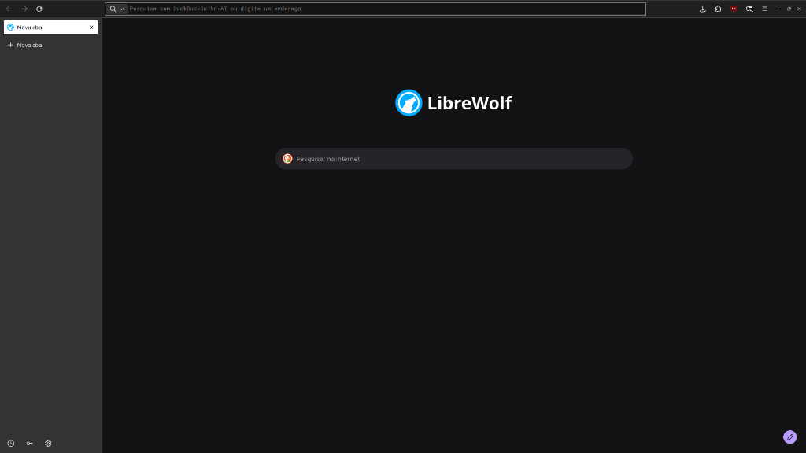
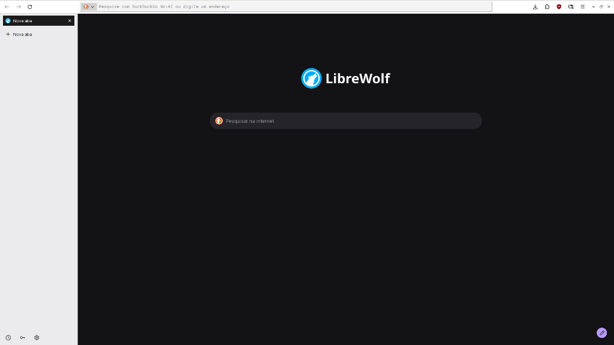

#  browsermaxxing / theme

square corners. quiet surfaces. black, white, and the space between.

a standalone `userChrome.css` theme for librewolf and firefox on linux.
reads your gtk or qt colors and stays out of your way. just shell and css.

| dark (horizontal) | light (horizontal) |
| :---: | :---: |
|  |  |
| **dark (vertical tabs)** | **light (vertical tabs)** |
|  |  |

---

## new to browser ricing? read this first

firefox and librewolf let you restyle the browser ui (tabs, url bar, menus) using a file called `userChrome.css` inside your profile folder.

by default, the browser ignores this file unless you tell it not to. there are two ways to enable it:

1. **the lazy way (automatic):** running `./install.sh` drops a `user.js` entry into your profile that enables custom css for you automatically. you don't have to touch a thing.
2. **the manual way (`about:config`):** if you ever want to check or toggle it yourself:
   - open a new tab and type `about:config` in the url bar (hit accept if it warns you).
   - search for `toolkit.legacyUserProfileCustomizations.stylesheets`.
   - double-click it so it says `true`.
   - restart the browser.

### how do i find my profile folder?

if you only have one profile, `./install.sh` finds it on its own.
if you have multiple profiles (or just wanna know where your files live):

- open a tab and go to `about:support` (or `about:profiles`).
- look for **profile directory** (or **root directory** — *not* the local/cache directory).
- copy that path. you can pass it to the scripts anytime with `-p /path/to/profile`.

---

## install (auto-sync mode)

close the browser first, then run from this repo:

```sh
./install.sh
```

what this does behind the scenes:
- backs up your existing `userChrome.css` and `user.js` so you never lose your old setup.
- enables `userChrome.css` support in your profile.
- grabs your current gtk or qt colors and generates the theme palette.
- sets up a lightweight `systemd --user` file watcher (`browsermaxxing.path`) that watches your gtk/qt config files. whenever you change your desktop theme, it updates the browser palette in the background automatically — zero cpu or ram wasted while idle.

for firefox, or if you want to pick a specific profile or color source (`gtk` or `qt`):

```sh
./install.sh --firefox
./install.sh -p ~/.mozilla/firefox/xxxx.default-release -s gtk
```

> note: browsers only load `userChrome.css` when they start up. when your desktop colors change, just close and reopen the browser whenever you're ready to see the new palette.

---

## update once (`run.sh`)

don't want a background watcher, or just want to trigger a color sync manually right now?

```sh
./run.sh
./run.sh -s qt
```

`./run.sh` reads your current gtk/qt colors, updates the palette once, and exits.
(if you want to install the theme without the background watcher in the first place, run `./install.sh --no-daemon` and just run `./run.sh` whenever you switch themes.)

---

## reset to default palette

tired of your desktop colors or want to go back to the classic monochrome look?
the built-in fallback palettes (`dark`, `light`, and `auto`) are always kept in your profile:

```sh
./run.sh -d
./run.sh -d light
./run.sh -d auto
```

you can also install the theme straight into the default monochrome palette from the start:

```sh
./install.sh -d
```

---

## uninstall

want to go back to how things were before? close the browser and run:

```sh
./install.sh -r
```

this stops and removes the `systemd --user` watcher, cleans up the theme files, and restores your original `userChrome.css` and `user.js` backups.
(if you edited the theme files by hand after installing, the script will protect your edits and ask you to pass `-f` if you're sure you want to wipe them.)

---

## quick cheat sheet

```sh
./install.sh              # install theme + background gtk/qt file watcher
./install.sh -d           # install with default dark monochrome palette
./install.sh -l           # list all detected librewolf / firefox profiles
./install.sh -r           # uninstall everything & restore backups

./run.sh                  # sync colors from gtk/qt once
./run.sh -s gtk           # force sync from gtk (or -s qt for qt/kde)
./run.sh -d               # reset palette to default dark (or light / auto)
./run.sh --print-palette  # preview generated css in terminal without saving
```

## tests

```sh
./tests/test_theme.sh
```
